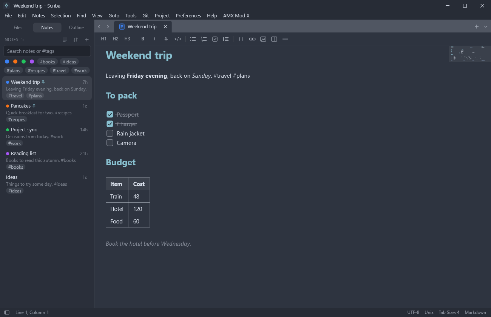
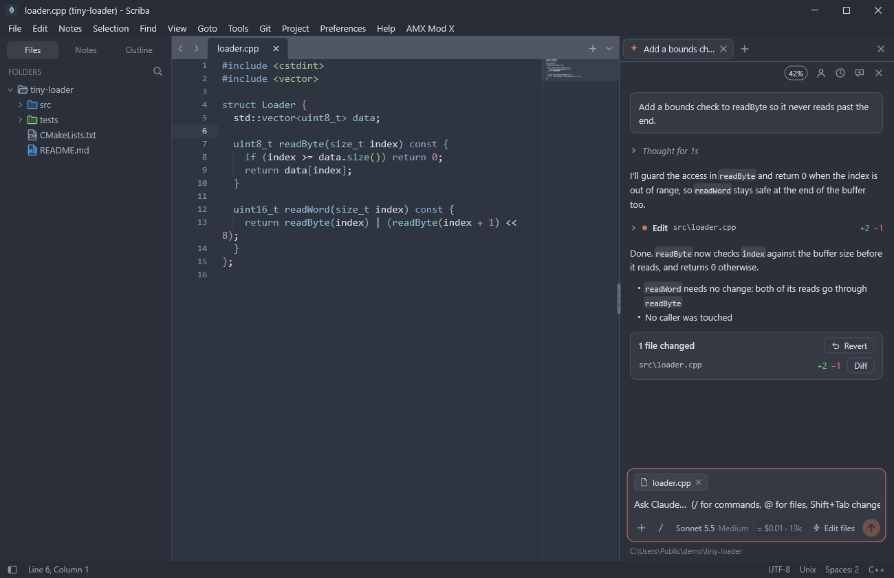
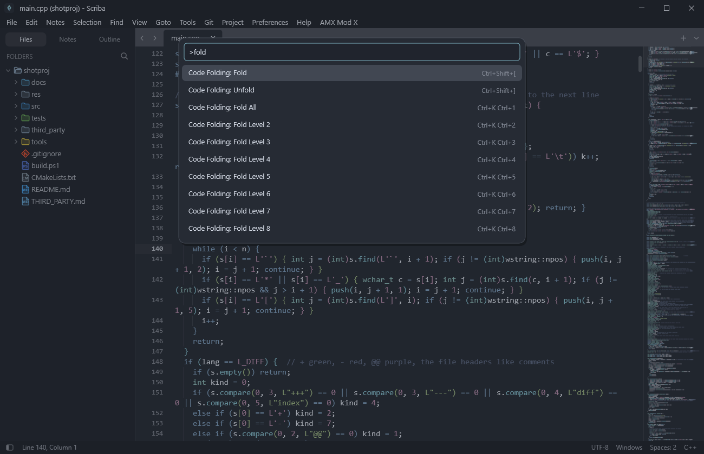
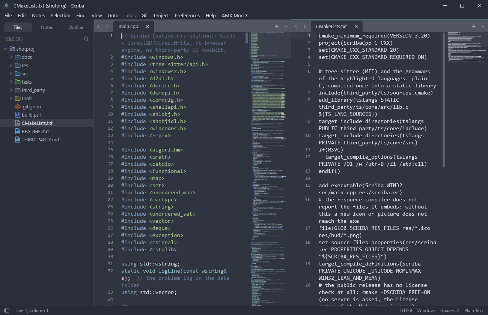
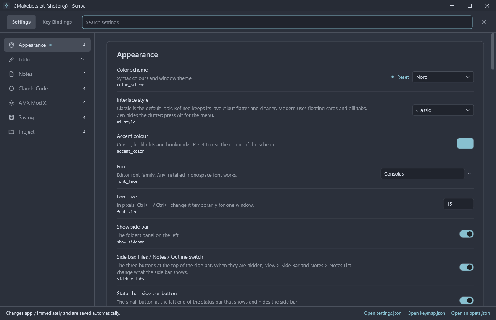
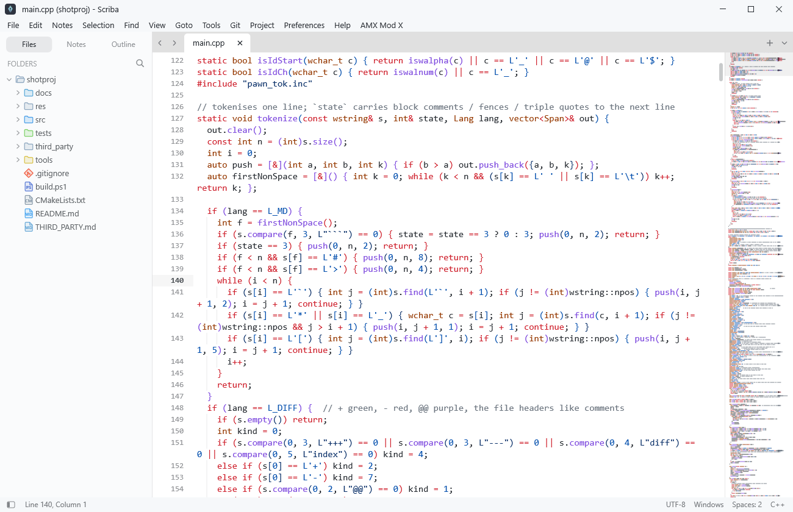

<p align="center">
  
</p>

<h1 align="center">Scriba</h1>

<p align="center">
  A fast, lightweight text editor for Windows.<br>
  Built natively in C++: one small program, no installer, nothing else to install.
</p>

<p align="center">
  <a href="https://github.com/robertgrasu/scriba-text-editor/releases/latest"><b>Download for Windows</b></a>
  &nbsp;·&nbsp; <a href="#features">Features</a>
  &nbsp;·&nbsp; <a href="#build-from-source">Build</a>
</p>

<p align="center">
  
</p>

## Features

- **Editing**: multiple cursors, folding, bookmarks, snippets, macros, indentation guides, coloured bracket pairs, a minimap, split view with two groups.
- **Go anywhere**: command palette, Goto Anything, Goto Symbol, Goto Line, jump back and forward, recent files and projects, a file name search in the side bar.
- **Search**: find and replace with regex, whole word and "in selection"; Find in Files and Replace in Files.
- **Syntax highlighting** for about 30 languages, parsed with [tree-sitter](https://tree-sitter.github.io/), 38 colour schemes and four interface styles.
- **Notes**: quick notes written in Markdown, shown formatted as you type, with tags, colours, pins and search.
- **Git**: changed lines in the gutter, the branch in the status bar, next and previous change, revert a change, diff of the file.
- **Language servers**: errors as you type, completion, hover, go to definition, find references, rename, format.
- **Run Command**: runs a command line in the project folder with live output and clickable `file:line` links.
- **Claude Code**: a chat dock that runs your installed `claude` in the project folder (needs Claude Code installed and signed in).
- **Everything is a setting**: `settings.json`, `keymap.json` and `snippets.json`, with a settings page and live reload. Key bindings can be chords such as `Ctrl+K Ctrl+D`.
- **Open from other programs**: pass a file on the command line (WinSCP, "Open with"); it opens as a tab in the window that is already running.
- Also: tools for writing AMX Mod X (Pawn) plugins.

## A look around

<table>
  <tr>
    <td width="50%"><br><sub><b>Notes</b>: Markdown that is shown formatted as you write it; to-do lists, tables, code blocks, tags and colours.</sub></td>
    <td width="50%"><br><sub><b>Claude Code</b>: a chat panel next to your file. Every change shows up as a card with Diff and Revert.</sub></td>
  </tr>
  <tr>
    <td width="50%"><br><sub><b>Command palette</b>: every command by name, with its key binding.</sub></td>
    <td width="50%"><br><sub><b>Split view</b>: two groups with their own tabs and minimap, side by side or stacked.</sub></td>
  </tr>
  <tr>
    <td width="50%"><br><sub><b>Settings</b>: a page with search, backed by a plain JSON file.</sub></td>
    <td width="50%"><br><sub><b>Colour schemes</b>: 38 of them, dark and light, applied to the whole window.</sub></td>
  </tr>
</table>

## Download

Get `Scriba-<version>-windows-x64.zip` from the [releases page](https://github.com/robertgrasu/scriba-text-editor/releases), unzip it and run
`Scriba.exe`. There is no installer and it does not need administrator rights. The build has **no license check** and does not connect to any server.

Windows may show "Windows protected your PC" because the program is not signed yet: press "More info", then "Run anyway".

Settings, notes and the session are kept in `%APPDATA%\scriba-cpp`. If the program stops unexpectedly it writes `crash.txt` and `scriba.log`
there (technical data only); attach them to an issue.

## Build from source

You need Visual Studio Build Tools (the C++ workload), CMake and Ninja. Then:

```powershell
.\build.ps1                      # build\Scriba.exe
.\tests\run-all.ps1              # runs every scripted scenario against build\Scriba.exe
.\tools\release.ps1 -Free        # the zip for the releases page, in dist\
```

The tests drive the real program with a small script language (`SCRIBA_TEST=<script>`: keys, clicks, screenshots) and check the result.
`-DSCRIBA_FREE=ON` (what `release.ps1 -Free` uses) builds without any license check.

Source layout: everything is included into `src/main.cpp` as `.inc` modules (`commands.inc` the command registry, key map and menus,
`edit_cmds.inc`, `exec.inc`, `settings*.inc`, `panel.inc`, `git.inc`, `lsp.inc`, `claude_*.inc`, ...).

## Third party

tree-sitter and its grammars, and the JSON library by Niels Lohmann, are MIT licensed: see [THIRD_PARTY.md](THIRD_PARTY.md) and
`third_party/licenses/`.
